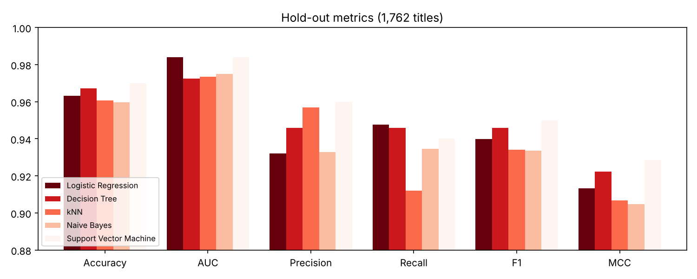
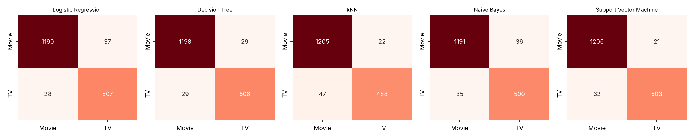

# 🎬 Netflix Catalog Classifier — Movie or TV Show?

Machine Learning – Assignment 2 · BITS Pilani WILP · M.Tech (DSE)

## a. Problem Statement
Given only the *metadata* of a title on Netflix (release/added dates, cast and director counts, genre themes,
maturity rating, title and description length …), predict whether it is a **Movie (0)** or a **TV Show (1)**.
Five classical classifiers are trained on the same data, compared on six metrics, and exposed through an
interactive Streamlit dashboard.

> The raw `duration` column ("90 min" / "2 Seasons") encodes the label directly, so it is **deliberately excluded**
> to avoid target leakage. Genre strings that literally contain "Movies"/"TV Shows" are collapsed into content
> themes (drama, comedy, crime …).

## b. Dataset Description
| Item | Value |
| :--- | :--- |
| Source | Netflix Movies and TV Shows (Kaggle, `netflix_titles.csv`) |
| Raw size | 8,807 titles × 12 columns (`data/netflix_titles.csv`) |
| Engineered features | **36** numeric features (≥ 12 required) |
| Instances | **8,807** (≥ 500 required) |
| Target | `target` — 1 = TV Show (30.4 %), 0 = Movie (69.6 %) → moderately imbalanced |
| Split | 80 / 20 stratified, `random_state=2026` → 7,045 train / 1,762 test (`test_data.csv`) |

Feature groups (see `features.py`):
* **Dates / counts** – `release_year`, `year_added`, `month_added`, `added_lag_years`, `n_countries`, `n_genres`, `n_cast`, `n_directors`
* **Text length** – `title_len`, `title_words`, `desc_len`, `desc_words`
* **Missingness flags** – `has_director`, `has_cast`, `has_country`, `has_date_added`
* **Genre themes (14)** – `theme_drama`, `theme_comedy`, `theme_action`, `theme_documentary`, `theme_kids`, `theme_romance`, `theme_thriller_horror`, `theme_scifi_fantasy`, `theme_crime`, `theme_reality`, `theme_anime`, `theme_music`, `theme_standup`, `theme_international`
* **Rating buckets** – `rating_adult`, `rating_teen`, `rating_family`, `rating_kids`, `rating_not_rated`, `rating_tv_style`

Pre-processing (inside each saved sklearn `Pipeline`): median imputation → standard scaling → classifier.
Hyper-parameters were tuned with 5-fold stratified CV (scoring = F1) on the training set only.

## c. GitHub Repository Link
`https://github.com/<your-username>/<your-repo>`  ← *replace with your repository URL*

Live app: `https://<your-app>.streamlit.app`  ← *replace after deployment*

```
├── app.py               Streamlit dashboard
├── evaluation.py        metric / plotting helpers shared by training and the app
├── features.py          feature engineering from the raw CSV
├── train_models.py      trains, tunes, evaluates and saves all 5 models
├── requirements.txt
├── test_data.csv        20 % hold-out (features + target) – upload this in the app
├── data/netflix_titles.csv
├── model/               *.joblib pipelines + metrics_summary.csv + training_info.json
└── assets/              charts used in this README
```
Reproduce: `pip install -r requirements.txt && python train_models.py && streamlit run app.py`

## d. Models Used

Metrics on the 1,762-row hold-out set (positive class = TV Show, decision threshold 0.5):

| ML Model Name | Accuracy | AUC | Precision | Recall | F1 | MCC |
| :--- | :---: | :---: | :---: | :---: | :---: | :---: |
| Logistic Regression | 0.9631 | 0.9841 | 0.9320 | 0.9477 | 0.9398 | 0.9132 |
| Decision Tree | 0.9671 | 0.9724 | 0.9458 | 0.9458 | 0.9458 | 0.9222 |
| kNN | 0.9608 | 0.9734 | 0.9569 | 0.9121 | 0.9340 | 0.9067 |
| Naive Bayes | 0.9597 | 0.9750 | 0.9328 | 0.9346 | 0.9337 | 0.9048 |
| **Support Vector Machine** | **0.9699** | **0.9841** | **0.9599** | 0.9402 | **0.9500** | **0.9286** |

Selected hyper-parameters: LR `C=0.1` · DT `max_depth=6, min_samples_leaf=5` · kNN `k=5, weights=distance` ·
GaussianNB `var_smoothing=1e-3` · SVM RBF `C=5, gamma=scale`. LR, DT and SVM use `class_weight="balanced"`.




### Observations on model performance

| ML Model Name | Observation about model performance |
| :--- | :--- |
| Logistic Regression | Ties for the best AUC (0.9841), so its ranking of titles is as good as the SVM's. With balanced class weights it gets the highest recall (0.9477) but the lowest precision (0.9320): it flags a few extra Movies as TV Shows. A linear boundary works because the strongest signals (missing director, theme flags, rating) are close to additive. |
| Decision Tree | A shallow tree (depth 6) reaches 0.9671 accuracy and MCC 0.9222, close to the SVM, and is fully interpretable. It splits first on `has_director` (TV shows rarely list a director). Its AUC (0.9724) is lower because a handful of leaves gives coarse probabilities. |
| kNN | Highest precision of the non-SVM models (0.9569) but the lowest recall (0.9121) and MCC (0.9067). Many of the 36 features are sparse binary flags, so Euclidean distance on scaled data dilutes the most informative ones, and neighbours tend to vote for the majority class (Movie). |
| Naive Bayes | Lowest accuracy (0.9597) and MCC (0.9048) but still strong. The Gaussian assumption is a poor fit for binary and count features and the features are correlated (e.g. `has_cast` / `n_cast`), yet its AUC of 0.9750 shows the probabilities are still usefully ordered. Fastest to train. |
| Support Vector Machine | Best accuracy (0.9699), precision (0.9599), F1 (0.9500) and MCC (0.9286), with AUC tied for best. The RBF kernel captures interactions such as "no director **and** crime/reality theme **and** TV-style rating" that the linear model cannot. |
| **Overall, Winner for your dataset?** | **Support Vector Machine (RBF)** — best on 5 of 6 metrics (AUC tied with Logistic Regression). The margins are small (≈0.3 pt accuracy over the Decision Tree) on a single split, so the top models are practically close; the Decision Tree is the best choice if interpretability matters. |

**Caveat / insight:** an ablation with a Decision Tree (5-fold CV F1) shows `has_director` dominates — dropping the
director features lowers F1 from ≈0.93 to ≈0.58. High scores therefore partly reflect a quirk of how Netflix lists
metadata (movies nearly always have a director, TV shows usually don't) rather than deep semantic understanding.

## e. Streamlit App
* Upload a CSV (use `test_data.csv`) or tick *use bundled test_data.csv*
* Dropdown to pick one of the 5 models, plus a decision-threshold slider
* Tab 1: six metrics, confusion matrix, ROC curve, classification report, prediction preview
* Tab 2: all five models side by side with a metric bar chart
* Tab 3: expected schema and training-time results
